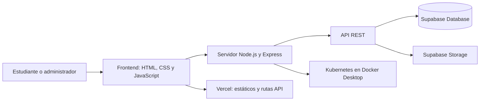

# WAGWAN — Plataforma de Cursos

Aplicación web académica para explorar y administrar cursos y clases de desarrollo de software e ingeniería de sistemas. La interfaz incluye un catálogo con búsqueda y filtros, vistas de detalle y un panel administrativo para gestionar contenidos educativos.


## Funcionalidades

- Explorar cursos por categorías como Programación, Algoritmos, Bases de Datos, Redes e Ingeniería de Software.
- Buscar cursos y consultar su información de detalle.
- Consultar clases guardadas desde la navegación de la aplicación.
- Acceder al panel administrativo para crear, editar, eliminar y cambiar el estado de contenidos.
- Cargar imágenes, documentos y enlaces a videos de clases.
- Destacar contenidos mediante banners y una sección de cursos destacados.

La aplicación obtiene los contenidos desde Supabase. La disponibilidad de cada función depende de la configuración de Supabase, sus permisos y los datos cargados.

## Arquitectura

El proyecto utiliza una aplicación Node.js/Express que sirve los archivos estáticos del frontend y expone la API. El backend se conecta a Supabase para los datos y el almacenamiento de archivos.



## Tecnologías

- **Backend:** Node.js, CommonJS y Express `^5.2.1`.
- **Frontend:** HTML, CSS y JavaScript.
- **Datos y almacenamiento:** Supabase (`@supabase/supabase-js` `^2.116.0`).
- **Carga de archivos:** Multer `^2.4.0`.
- **Configuración local:** dotenv `^17.4.2`.
- **Contenedor:** Node.js 22 sobre Alpine.
- **Despliegue configurado:** Vercel.
- **Orquestación local configurada:** Kubernetes con un Deployment y un Service NodePort.

Las versiones de dependencias son los rangos del manifiesto `package.json`. El Dockerfile utiliza Node 22; los workflows de CI incluyen Node 18, 20 y 22.

## Estructura principal

```text
.
├── .github/
│   └── workflows/        # Workflows de GitHub Actions
├── public/
│   ├── css/              # Estilos
│   ├── data/             # Datos JSON locales heredados
│   ├── js/               # Lógica del frontend
│   ├── media/            # Recursos gráficos
│   └── pages/            # Vistas adicionales
├── src/
│   ├── config/           # Configuración de Supabase
│   ├── controllers/      # Controladores
│   └── routes/           # Rutas API
├── Dockerfile
├── docker-compose.yml
├── k8s-deploy.yaml
├── package.json
├── package-lock.json
├── server.js
└── vercel.json
```

## Requisitos

- Node.js 22 recomendado para usar la misma versión definida por el Dockerfile.
- npm.
- Un proyecto Supabase configurado con las tablas y políticas que utiliza la aplicación y un bucket de Storage llamado `media`.

El código consulta las tablas `peliculas` y `usuarios`. La primera conserva el nombre de la versión anterior aunque la interfaz gestione cursos. El esquema SQL y las políticas de Supabase no están incluidos en este repositorio; deben verificarse en el proyecto Supabase utilizado por el equipo.

## Instalación y ejecución local

1. Clonar el repositorio e instalar dependencias:

   ```bash
   git clone https://github.com/Styngixx/wagwan-movie.git
   cd wagwan-movie
   npm ci
   ```

2. Crear un archivo `.env` local en la raíz:

   ```env
   PORT=3600
   SUPABASE_URL=https://tu-proyecto.supabase.co
   SUPABASE_KEY=tu_clave_de_supabase
   NODE_ENV=development
   ```

3. Iniciar el servidor:

   ```bash
   npm start
   ```

   Para desarrollo con reinicio automático:

   ```bash
   npm run dev
   ```

4. Abrir la aplicación en `http://localhost:3600`.


## Rutas principales de la aplicación

- `/` — página principal.
- `/admin` — acceso a la vista administrativa.
- `/detalle` — ruta de detalle servida por el servidor.
- `/pages/...` — páginas estáticas del frontend.
- `/api/...` — API REST.

## API disponible

Las rutas están montadas desde `src/routes/` por `server.js`. A pesar de que la interfaz habla de cursos, los endpoints actuales conservan el segmento `/peliculas`.

| Método | Endpoint | Función |
|---|---|---|
| `GET` | `/api/peliculas` | Lista los contenidos desde Supabase. |
| `POST` | `/api/peliculas` | Crea un contenido y puede recibir imagen/documento. |
| `PUT` | `/api/peliculas/:id` | Actualiza un contenido y admite reemplazar archivos. |
| `DELETE` | `/api/peliculas/:id` | Elimina el registro. |
| `PATCH` | `/api/peliculas/:id/estado` | Cambia el estado del contenido. |
| `PATCH` | `/api/peliculas/:id/vitrina` | Actualiza un campo de banner o destacado. |
| `POST` | `/api/auth/login` | Inicia sesión de administrador. |

Las cargas de archivos usan los campos `imagen` y `documento`; se guardan en el bucket `media`. El límite configurado para cada archivo es de 50 MB. El detalle se obtiene en el frontend a partir de la lista.

## GitHub Actions

Los workflows se encuentran en `.github/workflows/`:

- `ci-sebastian.yml`: verifica la página, revisa sintaxis del backend y ejecuta `npm ci` si hay lockfile.
- `ci-francis.yml`: ejecuta validaciones con Node 20 y 22 y construye una imagen Docker de prueba.
- `ci-david.yml`: instala dependencias con Node 18 en ramas seleccionadas.
- `ci-aldo.yml`: ejecuta `docker compose build` en ramas seleccionadas.
- `verificacion-mejiaCastro.yml`: instala dependencias con Node 20.

## Docker

El Dockerfile utiliza `node:22-alpine`, instala dependencias, expone el puerto `3600` y ejecuta `npm start`. Docker Compose configura un servicio, publica `3600:3600` y carga variables desde `.env`.

```bash
# Construir y ejecutar con Docker
docker build -t wagwan-movie:v1 .
docker run --rm -p 3600:3600 --env-file .env wagwan-movie:v1

# O utilizar Docker Compose
docker compose build
docker compose up
docker compose down
```

## Kubernetes con Docker Desktop

`k8s-deploy.yaml` declara:

- Un Deployment llamado `wagwan-movie-deployment`, con `replicas: 1`.
- Un contenedor que escucha en el puerto `3600`.
- Un Service `NodePort` que publica el puerto `30080` y dirige el tráfico al `3600`.
- La imagen local `wagwan-movie:v1`.

El manifiesto actual contiene valores de Supabase directamente en el YAML.

Con Kubernetes habilitado en Docker Desktop:

```powershell
docker build -t wagwan-movie:v1 .
kubectl config get-contexts
kubectl config use-context docker-desktop
```

Después de crear el Secret y actualizar el Deployment para leerlo con `secretKeyRef`:

```powershell
kubectl apply -f k8s-deploy.yaml
kubectl rollout status deployment/wagwan-movie-deployment
kubectl get deployments,pods,svc
kubectl port-forward svc/wagwan-movie-service 3600:3600
```

Mientras el port-forward esté activo, abre `http://localhost:3600`. También puedes probar `http://localhost:30080`, según la configuración del clúster local. La presencia del YAML no confirma que el despliegue se haya ejecutado; verifica que el pod esté `Ready` y captura la salida de los comandos.

## Despliegue en Vercel

`vercel.json` configura `server.js` como función Node y `public/**/*` como contenido estático. Las rutas `/api/...` se dirigen al servidor y las demás rutas al frontend.

1. Importa el repositorio en Vercel o usa la CLI.
2. Configura `SUPABASE_URL` y `SUPABASE_KEY` en las variables de entorno del proyecto.
3. Despliega y prueba la página y la API.
4. Registra aquí la URL cuando el despliegue esté confirmado: **[COMPLETAR: URL de producción]**.

También se puede usar `npx vercel --prod` después de iniciar sesión y configurar las variables. El repositorio incluye configuración para Vercel, pero eso no demuestra que exista un deployment activo.
